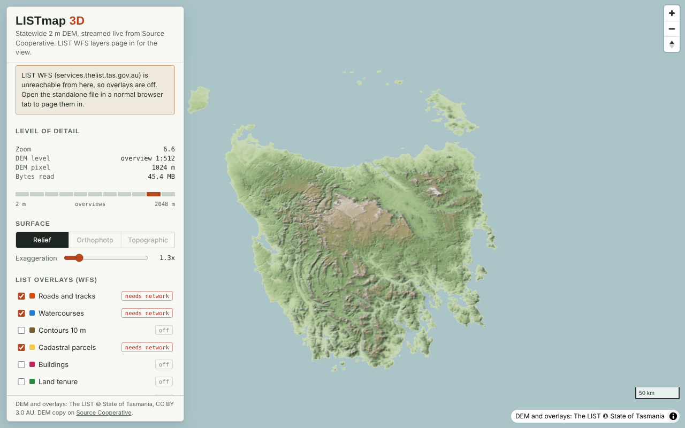
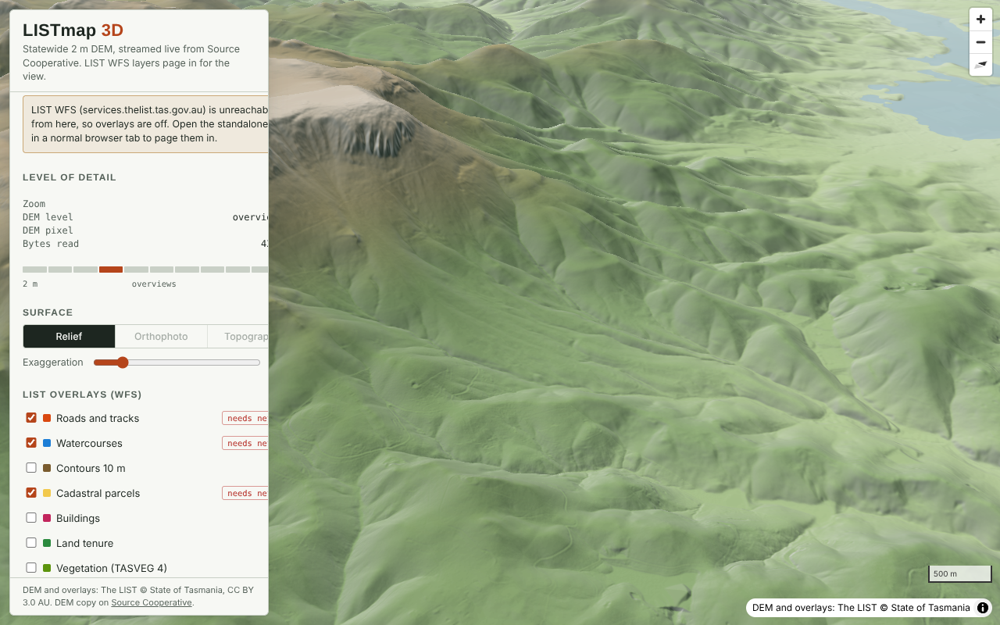

# listmap3d

A browser 3D viewer for the Tasmania 2 m DEM, with LIST open data WFS layers paged in for the current view.

Two viewers, same data and overlays:

- `maplibre/`: MapLibre GL. Terrain tiles are resampled from the COG into Web Mercator on the fly.
- `native/`: three.js. The view is in a projected CRS of your choice (MGA55 by default, the DEM's own grid),
  and terrain meshes are cut from the COG with no Web Mercator step. See [Native viewer](#native-viewer).

The root `index.html` links both. Open any of them in a browser (double-click works, or serve the folder, or turn on
GitHub Pages for `main` / root). There is no build step needed to run them; scripts come from jsDelivr.

## How it works

**DEM.** The 2 m DEM on Source Cooperative is a single 95 GB cloud-optimised GeoTIFF
(`Tasmania_Statewide_2m_DEM_14-08-2021.tif`, EPSG:28355, float32, LZW, 512 px tiles, overviews 2 to 1024). S3 serves
it with `Access-Control-Allow-Origin: *`:

    https://s3.us-west-2.amazonaws.com/us-west-2.opendata.source.coop/alexgleith/tasmania-dem-2m/Tasmania_Statewide_2m_DEM_14-08-2021.tif

A MapLibre custom protocol (`cogdem://`) builds each Web Mercator terrain tile on demand. It projects an 8 x 8 control
grid to MGA55 with proj4, picks the coarsest overview whose pixel is still finer than the screen pixel on the ground,
reads that window with geotiff.js range requests, resamples bilinearly, and encodes Terrarium RGB. The same tiles feed
the terrain mesh, the hillshade and the hypsometric tint. So the DEM has real level of detail: the whole state uses the
1:512 overview (about 1 km pixels) and street level uses the 2 m data.

**Overlays.** WFS 2.0 at
`https://services.thelist.tas.gov.au/arcgis/services/Public/OpenDataWFS/MapServer/WFSServer`, 56 feature types under
`Public_OpenDataWFS:`, requested as `outputFormat=GEOJSON`. Each layer has a minimum zoom. At or above it the viewer
requests Web Mercator cells (tiles at the layer's minimum zoom, the 16 nearest the view centre) with `count` and
`startIndex` paging (1000 per page, 4 pages per cell), dedupes on OBJECTID and drapes the result on the terrain. Click a
feature for its attributes. Any of the 56 layers can be added from the list under the curated ones.

The Orthophoto and Topographic buttons use the LIST Web Mercator tile caches
(`rest/services/Basemaps/Orthophoto` and `Basemaps/Topographic`, `MapServer/tile/{z}/{y}/{x}`).

**WFS quirk.** LIST's ArcGIS WFS reads a bare `bbox` as EPSG:4326 in **lat, lon** order and returns GEOJSON in lat, lon
order too, with a legacy `crs` member and the string `"null"` for empty fields. Asking for `srsName=EPSG:3857` gives
northing, easting. The viewer sends a lat, lon bbox and swaps coordinates back to lon, lat before drawing.

**Offline fallback.** If the live COG cannot be reached (for example in a sandboxed page), the viewer loads
`data/kunanyi_4m_dm.tif`, a 4 m int16-decimetre COG of kunanyi / Hobart (12.5 MB), and limits the view to it.

## Native viewer

`native/` drops MapLibre for three.js (WebGL) to get two things: freedom of CRS and less work per tile.

- **Tiles in the view CRS.** A quadtree over the DEM's extent in the chosen projection. Each tile is a 128 x 128 mesh
  (plus skirts to hide cracks between levels) sampled from the COG overview whose pixel matches the tile's spacing.
  Tiles split by screen-space error; the Detail slider sets the target error in pixels.
- **No reprojection for MGA55.** In the DEM's own CRS, sample positions map straight to COG pixels. In any other CRS
  each sample position is reprojected to MGA55 with proj4 (about 17k transforms per tile) before sampling.
- **Raw heights, no image encoding.** Heights go straight into the vertex buffer with normals from central differences.
  There is no Terrarium PNG encode and decode, and no separate hillshade source. Decoding runs in geotiff.js worker
  threads. Relief colour and shading are done in a small shader.
- **Overlays drawn into each tile's texture.** WFS features are projected into the view CRS once on arrival, then drawn
  into a 512 px canvas per tile, so they lie exactly on the ground at any exaggeration. Click picking works in the view
  CRS (point in polygon, distance to line).
- **Imagery in the view CRS.** The Orthophoto and Topographic modes ask ArcGIS `MapServer/export` for each tile's
  extent with `bboxSR`/`imageSR` set to the view CRS, so imagery needs a CRS with an EPSG code. Custom proj4 strings get
  Relief only.
- **Projections offered:** MGA55, a Lambert azimuthal equal-area centred on Tasmania, GA Lambert (EPSG:3112), Web
  Mercator, an oblique Mercator along the east coast, or any metric proj4 string.

Measured in headless Chromium (software GL, so frame times are not meaningful): the default kunanyi view read about
58 MB at Detail 3 px against about 44 MB for the MapLibre viewer, and building one tile from the local snapshot took
about 45 ms including decode. Bytes are dominated by the COG itself in both viewers.

What it does not have yet: labels, a scale bar, globe, smooth tile fade-in, and seamless normals across tiles of
different levels.

## Files

| Path | What it is |
| --- | --- |
| `index.html` | Landing page linking both viewers, copied from `src/index.html` |
| `maplibre/index.html` | The MapLibre viewer, built from `src/app.html` |
| `native/index.html` | The three.js native-CRS viewer, built from `src/native.html` |
| `src/app.html`, `src/native.html` | Page sources; the build inlines the MapLibre CSS |
| `tools/build.py` | Builds both pages, plus `out/` files for publishing as claude.ai artifacts (`npm install` first) |
| `tools/snap.py`, `tools/snapshot_int16.py` | Make the bundled snapshot from the statewide COG (needs rasterio) |
| `data/kunanyi_4m_dm.tif` | The bundled snapshot |

## Why it is local-bound, and what cloud-ready LIST data would fix

- **WFS has no level of detail.** Cadastre, buildings, roads and contours can only be shown close in. Every pan is a
  fresh set of server queries, and a dense cell is truncated at the paging cap. A statewide view of any of them is not
  possible this way. Vector tiles (PMTiles / MVT) or GeoParquet with a spatial index would remove the limit.
- **The DEM scales, at a cost.** It is already a COG, but opening it reads about 8 MB of header (tile offset arrays for
  roughly 500k full-resolution tiles) before the first pixel. Float32 with LZW and no predictor makes each view heavy:
  about 40 MB for a pitched valley view, and 25 MB more at street level. A floating-point predictor or LERC compression,
  per-region files, or a Terrarium / quantized-mesh tile pyramid would cut both.
- **The default WFS GeoJSON axis order (lat, lon) breaks standard GeoJSON readers.**

## Data

DEM and overlays: The LIST, (c) State of Tasmania, licensed CC BY 3.0 AU. DEM copy on
[Source Cooperative](https://source.coop/alexgleith/tasmania-dem-2m) uploaded by Alex Leith.
Libraries: [MapLibre GL JS](https://maplibre.org/), [geotiff.js](https://geotiffjs.github.io/), [proj4js](http://proj4js.org/).
